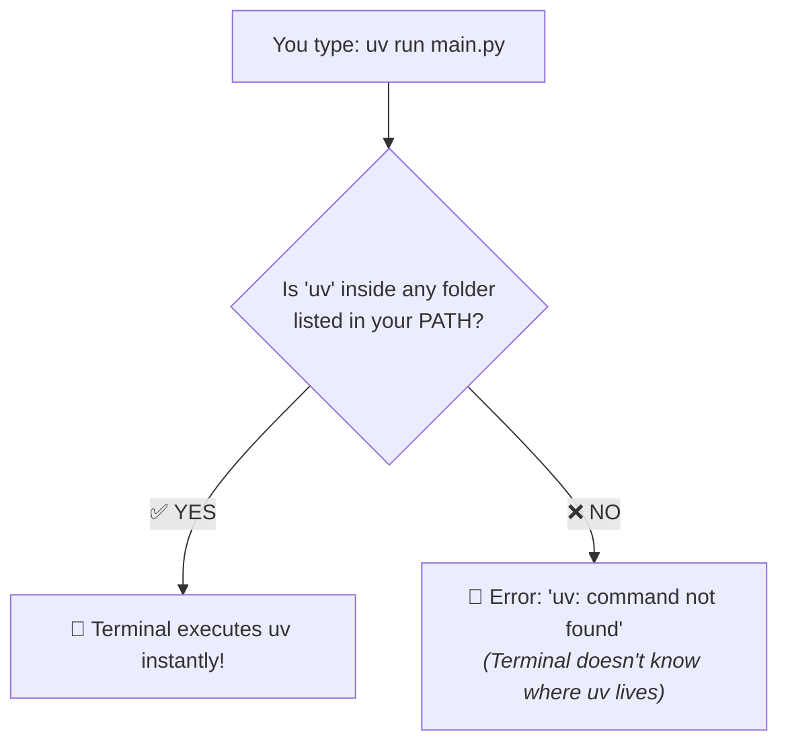

<div align="center">

# 🛠️ 00 — Prerequisites & Terminal Setup
### Prepare your terminal for a smooth, error-free Python experience

[⬅️ Home](../README.md) · **00 — Prerequisites** · [Next: 01 — Installation ➡️](../01-installation/README.md)

---

</div>

## 💡 Why Does This Matter?

> **Did you know?** 90% of beginner Python installation errors are **not** Python problems—they are terminal and permission misunderstandings!

Before installing `uv`, spending 2 minutes here guarantees you won't get stuck with frustrating errors like:
* 🛑 `'uv' is not recognized as an internal or external command`
* 🛑 `uv: command not found`
* 🛑 `File ... cannot be loaded because running scripts is disabled on this system`

---

## 🧭 Step 1: Know Your Terminal & Shell

Python tools run directly inside your computer's command-line interface. Let's make sure you know which one you are using:

| Operating System | Recommended Shell | How to Open (Fast Shortcut) | What It Looks Like |
|---|---|---|---|
| **🪟 Windows** | **PowerShell** *(Best)* | Press <kbd>Win</kbd> + <kbd>X</kbd> ➔ click **Terminal** or **PowerShell** | Prompt usually starts with `PS C:\Users\...>` |
| **🪟 Windows** | **Command Prompt (CMD)** | Press <kbd>Win</kbd> + <kbd>R</kbd> ➔ type `cmd` ➔ press <kbd>Enter</kbd> | Prompt starts with `C:\Users\...>` (no `PS`) |
| **🍎 macOS** | **Zsh** *(Default)* | Press <kbd>Cmd</kbd> + <kbd>Space</kbd> ➔ type `terminal` ➔ press <kbd>Enter</kbd> | Modern dark or white window running `zsh` |
| **🐧 Linux** | **Bash / Zsh** | Press <kbd>Ctrl</kbd> + <kbd>Alt</kbd> + <kbd>T</kbd> | Standard terminal window |

---

## 🪟 Step 2: Windows Setup (PowerShell & CMD)

<details open>
<summary><b>If you use Windows PowerShell (Recommended)</b></summary>
<br/>

### Fixing PowerShell Script Execution Permissions

By default, Windows locks down PowerShell to prevent downloaded scripts from running. If you don't adjust this, you will see this error later when activating virtual environments:

```powershell
File ...\Activate.ps1 cannot be loaded because running scripts is disabled on this system.
```

#### The 1-Line Fix:
Open **PowerShell** and run this command:

```powershell
Set-ExecutionPolicy -ExecutionPolicy RemoteSigned -Scope CurrentUser
```

#### Why is this safe?
* `-Scope CurrentUser`: Changes the setting **only for your user account**—no administrator rights required, and it won't affect other accounts.
* `RemoteSigned`: Lets you run your own local scripts freely, while requiring any scripts downloaded from the internet to have a verified digital signature.

#### Verify Your Setting:
Run:
```powershell
Get-ExecutionPolicy
```

**Expected output:**
```text
RemoteSigned
```
*(If it prints `RemoteSigned` or `Unrestricted`, your PowerShell is 100% ready!)*

</details>

<details>
<summary><b>If you use Windows Command Prompt (CMD)</b></summary>
<br/>

* **Script policies do NOT apply to CMD:** CMD does not have an execution policy security layer like PowerShell.
* **Important syntax difference:** The popular one-line installer `irm ... | iex` is PowerShell syntax. In CMD, you should either:
  1. Use **Winget** directly:
     ```cmd
     winget install --id=astral-sh.uv -e
     ```
  2. Or call PowerShell from CMD:
     ```cmd
     powershell -ExecutionPolicy ByPass -c "irm https://astral.sh/uv/install.ps1 | iex"
     ```

</details>

---

## 🍎 🐧 Step 3: macOS & Linux Shell Verification

When you install `uv` on macOS or Linux, the installer places the `uv` program inside `~/.local/bin`.

Most modern systems automatically recognize this folder. Let's make sure yours does:

### 1. Check your shell
Run:
```bash
echo $SHELL
```
* If you see `/bin/zsh` ➔ your startup file is `~/.zshrc`
* If you see `/bin/bash` ➔ your startup file is `~/.bashrc`

### 2. If `uv` is not recognized after install:
Add `~/.local/bin` to your shell profile with this single command:

```bash
# If using Zsh (default on macOS):
echo 'export PATH="$HOME/.local/bin:$PATH"' >> ~/.zshrc && source ~/.zshrc

# If using Bash (common on Linux):
echo 'export PATH="$HOME/.local/bin:$PATH"' >> ~/.bashrc && source ~/.bashrc
```

---

## 💡 Step 4: What is `PATH`? (The 30-Second Mental Model)

Think of your computer's **`PATH`** like your phone's **Contacts / Address Book**:

* When you call **"Mom"**, you don't type her full 10-digit phone number. Your phone looks up "Mom" in your Contacts and dials it for you.
* When you type **`uv`** or **`python`**, your terminal doesn't search your entire 1TB hard drive. It checks only the folders listed in its **`PATH` address book**.



### How to test if a program is in your PATH:

| Platform | Command to test | Expected Result if found |
|---|---|---|
| **Windows (PowerShell)** | `Get-Command uv` | Shows path to `uv.exe` |
| **Windows (CMD)** | `where uv` | Prints `C:\Users\...\uv.exe` |
| **macOS & Linux** | `which uv` | Prints `/Users/.../.local/bin/uv` |

---

## ⭐ The Golden Rule for Beginners

> [!IMPORTANT]
> **Always close and reopen your terminal after installing any new tool!**
> 
> When you install `uv`, your system updates its `PATH` variable behind the scenes. Any terminal window that is **already open** will not know about the new program until you restart the terminal!

---

## ✅ Readiness Checklist

Before moving to the next lesson, verify you can answer **YES** to these items:

- [ ] I know which terminal I am using (PowerShell, CMD, or Terminal on macOS/Linux).
- [ ] *(Windows PowerShell users)* I ran `Set-ExecutionPolicy -ExecutionPolicy RemoteSigned -Scope CurrentUser`.
- [ ] I understand that after installing `uv` in Step 01, I must **close and reopen** my terminal.

---

### 🎉 All set!
Proceed to the next lesson:
👉 **[01 — Installation & Python Setup ➡️](../01-installation/README.md)**
