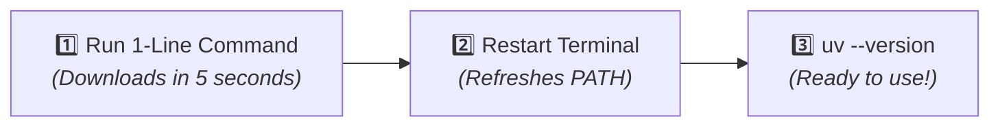

<div align="center">

# ⚡ 01 — Installing `uv` & Keeping It Updated
### Get `uv` up and running on your system in under 10 seconds

[⬅️ Home](../README.md) · [⬅️ 00 — Prerequisites](../00-prerequisites/README.md) · **01 — Installation** · [Next: Python Management ➡️](python-management.md)

---

</div>

## 💡 Why Installing `uv` is Effortless

Unlike traditional Python setups, `uv` has:
* **Zero dependencies:** Written in Rust as a single, standalone binary.
* **No existing Python needed:** You do **not** need Python installed on your machine to install or use `uv`.
* **No admin privileges required:** It installs safely inside your user directory without needing `sudo` or Administrator rights.



---

## 🚀 Choose Your Installation Command

Select your operating system and preferred shell:

<details open>
<summary><b>🪟 Windows (PowerShell) — Recommended</b></summary>
<br/>

Open **PowerShell** and paste this single command:

```powershell
powershell -ExecutionPolicy ByPass -c "irm https://astral.sh/uv/install.ps1 | iex"
```

* `-ExecutionPolicy ByPass`: Ensures the installer script runs smoothly without triggering policy blocks.
* `irm`: Short for `Invoke-RestMethod` (downloads the installer securely over HTTPS).
* `iex`: Short for `Invoke-Expression` (runs the installer).

</details>

<details>
<summary><b>🪟 Windows (Command Prompt / CMD)</b></summary>
<br/>

If you prefer **CMD**, you have two simple choices:

**Method 1: Windows Package Manager (Winget)**
```cmd
winget install --id=astral-sh.uv -e
```

**Method 2: Official installer via CMD**
```cmd
powershell -ExecutionPolicy ByPass -c "irm https://astral.sh/uv/install.ps1 | iex"
```

</details>

<details>
<summary><b>🍎 macOS & 🐧 Linux</b></summary>
<br/>

Open your **Terminal** and paste:

```bash
curl -LsSf https://astral.sh/uv/install.sh | sh
```

*Alternative for macOS via Homebrew:*
```bash
brew install uv
```

> [!NOTE]
> **A Note on Security & Transparency:**
> The `curl | sh` and `irm | iex` patterns are official developer standards used by Rust, Homebrew, and Astral. Everything runs securely over HTTPS directly from Astral's verified domain (`astral.sh`). You can view the open-source installer scripts anytime by visiting `https://astral.sh/uv/install.ps1` or `https://astral.sh/uv/install.sh` in your browser.

</details>

---

## 🔄 Step 2: Restart Your Terminal

> [!IMPORTANT]
> **Don't skip this step!**
> After the installer completes, **close your terminal window and open a new one**.
> This forces your shell to refresh its `PATH` and instantly discover the new `uv` command.

---

## 🔍 Step 3: Verify the Installation

In your **new** terminal window, type:

```bash
uv --version
```

### Expected Output:
```text
uv 0.5.15 (or newer)
```

🎉 **If any version number prints to your screen, `uv` is successfully installed and ready!**

*(If you see `'uv' is not recognized` or `command not found`, jump back to **[00 — Prerequisites](../00-prerequisites/README.md)** to verify your terminal PATH.)*

---

## ⚡ Keeping `uv` Updated

Astral releases speed improvements and updates frequently. Updating `uv` takes one command:

```bash
uv self update
```

*(If you installed via `brew` or `winget`, you can also run `brew upgrade uv` or `winget upgrade astral-sh.uv`.)*

---

## 📋 Quick Reference: Installation Commands

| Operating System | Recommended Command | Alternative |
|---|---|---|
| **Windows (PowerShell)** | `powershell -ExecutionPolicy ByPass -c "irm https://astral.sh/uv/install.ps1 \| iex"` | `winget install --id=astral-sh.uv -e` |
| **Windows (CMD)** | `winget install --id=astral-sh.uv -e` | `powershell -ExecutionPolicy ByPass -c "irm https://astral.sh/uv/install.ps1 \| iex"` |
| **macOS** | `curl -LsSf https://astral.sh/uv/install.sh \| sh` | `brew install uv` |
| **Linux / WSL** | `curl -LsSf https://astral.sh/uv/install.sh \| sh` | `cargo install --git https://github.com/astral-sh/uv uv` |

---

## ⏭️ Next Step

Now that `uv` is ready, you **never** need to manually download Python from `python.org` again! Learn how `uv` automatically downloads and switches Python versions for you in:

👉 **[Part 2: Managing Python Versions with `uv` ➡️](python-management.md)**
