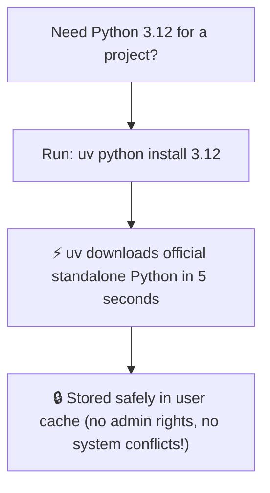

<div align="center">

# 🐍 Managing Python Versions with `uv`
### Download, switch, and pin Python versions with zero installers and zero conflicts

[⬅️ Home](../README.md) · [⬅️ 01 — Installation](README.md) · **Python Management** · [Next: 02 — First Project ➡️](../02-first-project/README.md)

---

</div>

## 💡 The Big Reveal: No More `python.org` Installers!

Historically, getting Python onto a computer was the most painful part of learning to code:
* 🛑 Forgetting to check the *"Add Python to PATH"* checkbox in Windows installers.
* 🛑 Multiple conflicting Python versions breaking each other.
* 🛑 Permission errors when installing packages (`sudo pip` or corrupted global packages).
* 🛑 Needing complex version managers like `pyenv`, `asdf`, or Anaconda.

**`uv` makes all of that obsolete.** `uv` can download, install, switch, and pin standalone, official Python builds directly into an isolated user folder.



---

## 🔎 1. Discover Available Python Versions (`uv python list`)

To see what versions of Python you have installed—and what versions you can download:

```bash
uv python list
```

### What You Will See:
```text
cpython-3.13.1-windows-x86_64-none    <download available>
cpython-3.12.8-windows-x86_64-none    C:\Users\...\.local\share\uv\python\...
cpython-3.11.11-windows-x86_64-none   <download available>
cpython-3.10.16-windows-x86_64-none   <download available>
```
* Versions with a file path are **already on your machine**.
* Versions labeled `<download available>` can be installed instantly with one command.

---

## 📥 2. Install Any Python Version in Seconds (`uv python install`)

Need Python 3.12? You don't need to visit a website or run a wizard. Just type:

```bash
uv python install 3.12
```

Want to test a script with Python 3.11 or the latest Python 3.13?
```bash
uv python install 3.11
uv python install 3.13
```

`uv` downloads the standalone version and sets it up automatically.

---

## 📌 3. Pin Python for a Project (`uv python pin`)

When sharing code with teammates or running tutorials, you want everyone to use the exact same Python version.

Inside any project folder, run:

```bash
uv python pin 3.12
```

### What happens?
`uv` writes a small file named `.python-version` containing `3.12`. 
From that moment on, whenever anyone runs `uv run` or `uv add` inside that project, **`uv` will automatically use Python 3.12**.

---

## 📍 4. Find Where Python Lives (`uv python find`)

Need to find the exact path to your Python interpreter (for example, to configure an IDE like VS Code or PyCharm)?

```bash
# Find the active default Python:
uv python find

# Find a specific installed version:
uv python find 3.12
```

**Expected output:**
```text
C:\Users\user\.local\share\uv\python\cpython-3.12.8-windows-x86_64-none\python.exe
```

---

## 🗑️ 5. Free Up Disk Space (`uv python uninstall`)

If you no longer need an older Python version, removing it takes one command:

```bash
uv python uninstall 3.10
```

---

## 📋 Pocket Cheat Sheet: Python Management

| Action | Command | What It Does |
|---|---|---|
| **See all Python versions** | `uv python list` | Lists installed and available versions |
| **Download & install Python** | `uv python install 3.12` | Installs Python 3.12 in ~5 seconds |
| **Lock version for project** | `uv python pin 3.12` | Creates `.python-version` file |
| **Find Python executable** | `uv python find 3.12` | Prints exact file path to `python.exe` |
| **Remove a Python version** | `uv python uninstall 3.10` | Removes version from user cache |

---

## ⭐ The Golden Takeaway for Beginners

> [!TIP]
> **You don't even need to run `uv python install` manually!**
> If you create a project with `uv init` or run a script with `uv run`, `uv` will detect if you are missing Python and **download it for you automatically** in the background!

---

## ⏭️ Ready to Build?

Now that `uv` and Python are completely set up, let's create your first real project!

👉 **[02 — Your First Project ➡️](../02-first-project/README.md)**
