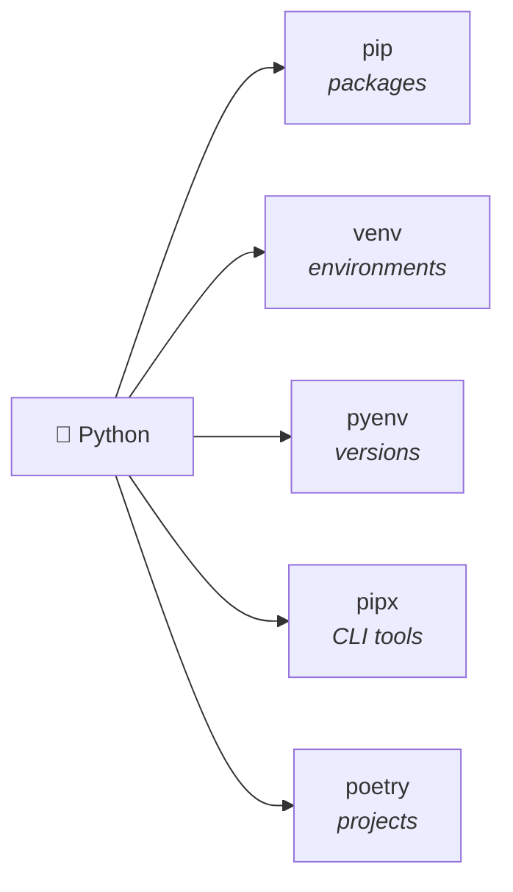

<div align="center">

# ⚡ uv for Beginners
### The Fast, Modern Python Package Manager

**Zero headaches. Blazingly fast. Made for beginners, students, and pros.**

[](https://www.python.org/)
[](https://docs.astral.sh/uv/)
[](#-quickstart)
[](LICENSE)

---

</div>

## 💡 Why `uv`?

Python projects often make beginners juggle several tools. `uv` brings the
most common jobs into one fast, consistent workflow.

### The old way: five tools, five mental models



### The uv way: one workflow


You can install Python versions, manage dependencies, create environments, and
run tools without memorizing a different workflow for each task.

---

## ⚡ Quickstart

### Step 1: Install `uv`

<details open>
<summary><b>Select your operating system</b></summary>
<br/>

* **🪟 Windows (PowerShell):**
  ```powershell
  powershell -ExecutionPolicy ByPass -c "irm https://astral.sh/uv/install.ps1 | iex"
  ```
* **🪟 Windows (Command Prompt / CMD):**
  ```cmd
  winget install --id=astral-sh.uv -e
  ```
* **🍎 macOS & 🐧 Linux:**
  ```bash
  curl -LsSf https://astral.sh/uv/install.sh | sh
  ```

> ⚠️ **Important:** Close and reopen your terminal after installation! Then verify:
> ```bash
> uv --version
> ```

> **Expected result:** your terminal prints a version such as `uv 0.x.x`.
> Any version number means the installation worked.
</details>

### Step 2: Create & Run Your First App (30 seconds)

```bash
# 1. Create a new project folder
uv init my-app
cd my-app

# 2. Add any library you want (e.g. cowsay or requests)
uv add cowsay

# 3. Run it! (uv creates the environment automatically)
uv run hello.py
```

*🎉 That's it! No `python -m venv`, no activating scripts, no broken PATH errors.*

---

## 🗺️ Step-by-Step Curriculum

Start at **Lesson 00** if you are new to the terminal, or jump to any topic below:

| Lesson | Focus | What You'll Learn |
|:---:|---|---|
| **[00](00-prerequisites/README.md)** | **[Prerequisites & Terminal](00-prerequisites/README.md)** | PowerShell execution policies, CMD tips, and understanding `PATH`. |
| **[01](01-installation/README.md)** | **[Installation & Python Setup](01-installation/README.md)** | Install `uv`, update it, and download Python with `uv python`. |
| **[02](02-first-project/README.md)** | **[Your First Project](02-first-project/README.md)** | Deep dive into `uv init`, `pyproject.toml`, `uv.lock`, and `uv run`. |
| **[03](03-jupyter-setup/README.md)** | **[Jupyter & VS Code](03-jupyter-setup/README.md)** | Seamless data science notebooks and kernel selection in VS Code. |
| **[04](04-dependency-mgmt/README.md)** | **[Managing Dependencies](04-dependency-mgmt/README.md)** | Adding (`uv add`), dev tools (`--dev`), removing, and lockfiles (`uv sync`). |
| **[05](05-single-file-scripts/README.md)** | **[Single-File Scripts](05-single-file-scripts/README.md)** | Run standalone `.py` scripts with inline dependencies (PEP 723). |
| **[06](06-tools-and-uvx/README.md)** | **[CLI Tools & `uvx`](06-tools-and-uvx/README.md)** | Run linters and tools like `ruff` or `black` without installing them. |
| **[07](07-migration/README.md)** | **[Migration Guide](07-migration/README.md)** | Move from `requirements.txt`, `pip`, or Conda in under 60 seconds. |

---

## 🎯 Choose Your Track

<table>
<tr>
<td width="50%"><strong>🎓 Complete beginner</strong><br/><a href="00-prerequisites/README.md">Start with the prerequisites</a><br/><small>Configure your terminal and PATH.</small></td>
<td width="50%"><strong>📊 Data science</strong><br/><a href="03-jupyter-setup/README.md">Set up Jupyter + VS Code</a><br/><small>Or open the ready-to-run example.</small></td>
</tr>
<tr>
<td><strong>⚡ Quick script</strong><br/><a href="05-single-file-scripts/README.md">Run a single-file script</a><br/><small>Use inline dependencies without a project.</small></td>
<td><strong>🔄 Existing project</strong><br/><a href="07-migration/README.md">Follow the migration guide</a><br/><small>Move from pip, requirements.txt, or Conda.</small></td>
</tr>
</table>

---

## 📌 Pocket Cheat Sheet

The commands you will use 95% of the time:

| Action | Command |
|---|---|
| **Install a Python version** | `uv python install 3.12` |
| **Create a new project** | `uv init <project-name>` |
| **Add a package** | `uv add <package>` |
| **Add a dev/test tool** | `uv add --dev pytest` |
| **Remove a package** | `uv remove <package>` |
| **Run your script / project** | `uv run <script.py>` |
| **Sync dependencies to match lockfile** | `uv sync` |
| **Run a CLI tool without installing** | `uvx <tool>` *(e.g. `uvx ruff check .`)* |
| **Upgrade uv to latest version** | `uv self update` |

---

## 🆘 Need Help?

* 🔍 Check our **[FAQ & Common Mistakes Guide](FAQ.md)** for quick answers to common questions (e.g., *"Why can't VS Code find my packages?"*).
* 📖 Official Documentation: [docs.astral.sh/uv](https://docs.astral.sh/uv/)
* 💬 Community & Feedback: [github.com/servasadolph/uv-beginners-learn](https://github.com/servasadolph/uv-beginners-learn)
